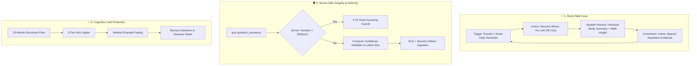

# BSU Math & AI Portal — Master Behavioral & Psychological Engineering Plan (v2.1 Refined)
## Architecture Specification for Behavioral Psychology, Spaced Repetition, and Math Anxiety Reduction

> **Primary Objective:** Transform the learning of abstract collegiate mathematics from an anxiety-inducing, burnout-heavy chore into a **lightweight, psychologically safe, and intellectually engaging daily habit** for Mathematics Education undergraduates at Beni-Suef University.  
> **Baseline State:** Codebase baseline frozen and tagged at `v1.1.0-gamification`. Initial media playback verified at 0 XP for early intervals (<10 seconds).

---

## 🧭 Core Architectural Tenets

1. **Learning Before Points:** Gamification serves cognitive comprehension, never vanity metrics. If student points increase without retention, the engine has failed.
2. **Absolute Server Authority:** Speed filtering, confidence validation, spaced-repetition scheduling, and state transitions are strictly governed server-side via PostgreSQL RPCs and Row Level Security (RLS), never trusting client claims.
3. **Cognitive Load Protection:** No marathon, fatiguing study sessions. A focused, structured 25-minute flow beats hours of distracted burnout.
4. **Compassionate Failure:** A wrong answer is not an offense; it is the most valuable learning trigger. Negative, punitive feedback (`❌ Wrong Answer`) is replaced with targeted diagnostic insights.
5. **Zero-Friction Entry:** Initiating daily learning must take fewer than 2 seconds of cognitive deliberation ("Start Paralysis" mitigation).

---



---

## 🗺️ Refined Phase Execution Roadmap

| Phase | Functional Title | Core Objective | Status & Deliverables |
| :--- | :--- | :--- | :--- |
| **Phase 1** | **Frictionless Habit Ignition** | Eliminate start paralysis and capture KPI telemetry | ✅ **COMPLETED & DEPLOYED** — "Resume Where You Left Off" hero card + 5-min micro-session modal + Ethical wrap-up modal + `session.*` telemetry + DB RPC & columns |
| **Phase 2** | **Leitner Mistake Notebook** | Convert quiz errors into spaced retention assets | ⏳ **NEXT IN QUEUE** — Fine-grained `quiz.question_answered` event + `mistake_notebook` table (Boxes 1–5) + `submit_mistake_review` RPC + Server-side automatic ingestion |
| **Phase 3** | **Cognitive Guard & Hint Ladder** | Break down complex proofs and preserve momentum | 📋 Planned — 3-tier scaffolding hint ladder + Worked example fading + Client burnout detector |
| **Phase 4** | **Compassionate Feedback** | Mitigate math anxiety with constructive diagnostic support | 📋 Planned — Diagnostic feedback engine + Dynamic collegiate praise bank (separate Boys & Girls personas) + Micro-delight haptics |
| **Phase 5** | **Sybil-Proof Fair Gamification** | Align points strictly with comprehension | 📋 Planned — Flexible study streak (2 weekly auto-freezes) + Pre-answer confidence rating + Server-side speed guard (<3s) + 10-peer neighborhood leaderboard |
| **Phase 6** | **Collaborative Cohort Challenge** | Foster cohort solidarity without row contention | 📋 Planned — Append-only `cohort_challenge_contributions` table + Daily student contribution caps + Asynchronous materialized rollups |

---

## 📋 Comprehensive Phase Specifications

---

### 🔷 Phase 1: Frictionless Habit Ignition & Telemetry Tracking
> **Status:** ✅ **COMPLETED, TESTED & DEPLOYED** (Vitest: 42/42 passing, Turbopack Build: OK, Supabase Migration: OK)  
> **Principle:** College students struggle most with initiation paralysis ("Where do I even start?"). We reduce this friction to a single click taking under 2 seconds.

#### 1. Zero-Redundancy Smart Resume Architecture
* **Design Decision:** Avoid redundant tables (such as `student_resume_state`) by leveraging existing schemas:
  - In `public.profiles`:
    - `last_active_lecture_id INT REFERENCES public.lectures(id) ON DELETE SET NULL`
    - `last_active_tab TEXT DEFAULT 'guide'`
  - In `public.lecture_progress`:
    - Leverage existing `media_progress JSONB` column to store playback state:
      ```json
      {
        "audioSec": 745.2,
        "videoSec": 120.0,
        "cardIndex": 4,
        "lastTab": "audio",
        "updatedAt": 1729384920000
      }
      ```
  - **Storage & Throttling Rules:**
    - Local storage writes occur synchronously for 0ms UI hydration.
    - Remote Supabase updates are throttled to once every **25 seconds** during continuous playback.
    - Immediate remote flush is triggered on `pause`, `ended`, tab switch, or window unload (`pagehide` / `visibilitychange: hidden`).
  - **Homepage Hero Placement:**
    - High-visibility `SmartResumeCard.tsx` widget:
      > **"Resume Where You Left Off: Statics — Lecture 3 (Min 12:45 of Podcast)"**  
      > Broad action button resuming playback in `< 2 seconds`.

#### 2. 5-Minute Micro-Session ("جلسة الـ 5 دقائق")
* Designed for busy transit periods or high-friction days:
  - Structure: **3 Concept Flashcards + 1 High-Yield Quiz Question**.
  - **Streak Movement & Anti-Cheat Rule:** To prevent cheap streak forging (e.g. flipping 3 cards and answering in 5 seconds), the question answer MUST satisfy `durationMs >= 3000`. Fast guesses (<3000ms) yield 0 XP and do **not** advance the daily streak.
  - **Governing Streak Event:** The streak is driven by `quiz.finished` (with `durationMs >= 3000` and `total >= 1`) or `quiz.question_answered` (with `durationMs >= 3000` and `isCorrect = true`), which are verified inside `isCompletedActivity()`.
  - Ultra-lightweight on mobile data bandwidth.

#### 3. Ethical Wrap-Up Modal ("خلصت لليوم، استريح ☕")
* Intentional exit button: **"Finished Studying for Today ☕"**.
* Supportive summary modal highlighting concrete accomplishments:
  > "Outstanding work! Today you mastered **2 core concepts**, reviewed **6 flashcards**, and completed a quiz with **85% accuracy**. Your brain needs rest to consolidate neural pathways. Grab a drink and relax 🌿"
* Enforces quiet mode on notifications for the remainder of the Cairo day.

#### 4. KPI Telemetry Events
Defined in `src/shared/events/types.ts`:
- `session.started`: `{ sessionId: string, deviceType: 'mobile' | 'desktop' }`
- `session.first_action`: `{ sessionId: string, actionType: string, timeToFirstActionMs: number }` (Directly measures time-to-first-action KPI < 5s).
- `session.ended`: `{ sessionId: string, durationSec: number, conceptsLearned: number, cardsReviewed: number, quizAccuracy: number }`
- **Zero XP Guarantee:** All `session.*` events award 0 XP and are excluded from `isCompletedActivity`.

---

### 🔷 Phase 2: Leitner Mistake Notebook & Spaced Repetition

> **Principle:** Every error made in a quiz is an invaluable learning opportunity sent to the "Mistake Notebook" for retrieval practice following Leitner boxes.

#### 1. Deterministic 5-Box Leitner Algorithm
Replaced floating-point SM-2 parameters with deterministic, transparent Leitner intervals:
* **Box 1:** Review due in **1 day** (24 hours Cairo time).
* **Box 2:** Review due in **3 days** (72 hours).
* **Box 3:** Review due in **7 days** (1 week).
* **Box 4:** Review due in **14 days** (2 weeks).
* **Box 5:** Mastered / Review due in **30 days**.
* **Demotion Law:** Any incorrect review response immediately drops the question back to **Box 1**.

#### 2. Detailed Answer Ingestion Event (`quiz.question_answered`)
```typescript
export interface QuizQuestionAnsweredPayload {
  lectureId: number; // Primary key references public.lectures(id)
  questionIndex: number;
  questionHash: string; // SHA-256 of normalized question text
  questionText: string;
  selectedOption: number;
  correctOption: number;
  userAnswer: string; // Literal text of student's choice
  correctAnswer: string; // Literal text of correct answer
  explanation?: string; // Pedagogical explanation text
  isCorrect: boolean;
  durationMs: number;
  confidence: 'high' | 'medium' | 'low';
  hintLevelUsed: 0 | 1 | 2 | 3;
}
```

#### 3. Database Schema & Row-Level Security (`public.mistake_notebook`)
```sql
CREATE TABLE IF NOT EXISTS public.mistake_notebook (
    id UUID PRIMARY KEY DEFAULT gen_random_uuid(),
    user_id UUID NOT NULL REFERENCES auth.users(id) ON DELETE CASCADE,
    lecture_id INT NOT NULL REFERENCES public.lectures(id) ON DELETE CASCADE,
    question_hash TEXT NOT NULL,
    question_text TEXT NOT NULL,
    correct_answer TEXT NOT NULL,
    user_last_mistake TEXT NOT NULL,
    explanation TEXT,
    box_level INT NOT NULL DEFAULT 1 CHECK (box_level BETWEEN 1 AND 5),
    next_review_date DATE NOT NULL,
    is_mastered BOOLEAN NOT NULL DEFAULT false,
    created_at TIMESTAMPTZ NOT NULL DEFAULT now(),
    updated_at TIMESTAMPTZ NOT NULL DEFAULT now(),
    UNIQUE(user_id, question_hash)
);

-- RLS: Clients have read-only access to their own notebook records
ALTER TABLE public.mistake_notebook ENABLE ROW LEVEL SECURITY;

CREATE POLICY "Users can view their own mistakes" 
ON public.mistake_notebook FOR SELECT 
USING (auth.uid() = user_id);

-- Direct client INSERT, UPDATE, and DELETE are strictly forbidden.
-- All state transitions occur through SECURITY DEFINER stored procedures.
```

#### 4. Validated Review Procedure (`submit_mistake_review`)
Incorporating the 5 critical security and architectural safeguards:
1. **Due Date Anti-Spam Check:** Question must be due today (`next_review_date <= cairo_today`).
2. **Speed Filter Safeguard:** Fast answers (<3s) zero out XP (`awarded_xp := 0`) but do **not** demote the student's box level if correct.
3. **Unified Event Pipeline:** Review XP is routed through `ingest_events` to honor daily caps, level-ups, and idempotency. The RPC returns the authoritative `awardedXp` produced by `ingest_events`.
4. **Anti-Replay Authority:** Exactly 1 review XP reward per `(user, question_hash)` per Cairo day.
5. **Caller Separation of Concerns:** The Mistake Notebook UI invokes `submit_mistake_review` ONLY; it is strictly prohibited from emitting `quiz.question_answered` to prevent redundant box demotions.

```sql
CREATE OR REPLACE FUNCTION public.submit_mistake_review(
    p_question_hash TEXT,
    p_is_correct BOOLEAN,
    p_duration_ms INT
)
RETURNS JSONB
LANGUAGE plpgsql
SECURITY DEFINER
SET search_path = public, auth
AS $$
DECLARE
    caller_id UUID := auth.uid();
    cairo_today DATE := (now() AT TIME ZONE 'Africa/Cairo')::DATE;
    rec public.mistake_notebook%ROWTYPE;
    next_box INT;
    interval_days INT;
    awarded_xp INT := 0;
    already_reviewed_today BOOLEAN;
    ingest_res JSONB;
BEGIN
    IF caller_id IS NULL THEN
        RAISE EXCEPTION 'Authentication required.';
    END IF;

    SELECT * INTO rec FROM public.mistake_notebook 
    WHERE user_id = caller_id AND question_hash = p_question_hash
    FOR UPDATE;

    IF NOT FOUND THEN
        RAISE EXCEPTION 'Question not found in mistake notebook.';
    END IF;

    -- 1. Anti-Cheat: Validate that the review is actually due today
    IF rec.next_review_date > cairo_today THEN
        RAISE EXCEPTION 'Question is not due for review yet (Due: %).', rec.next_review_date;
    END IF;

    -- 2. Box Transition & Thoughtfulness Speed Guard
    IF p_is_correct THEN
        next_box := LEAST(5, rec.box_level + 1);
        interval_days := CASE next_box
            WHEN 2 THEN 3
            WHEN 3 THEN 7
            WHEN 4 THEN 14
            WHEN 5 THEN 30
            ELSE 1
        END;
    ELSE
        -- Immediate demotion to Box 1 on mistake
        next_box := 1;
        interval_days := 1;
    END IF;

    -- 3. Update Notebook Record
    UPDATE public.mistake_notebook SET
        box_level = next_box,
        next_review_date = cairo_today + interval_days,
        is_mastered = (next_box = 5),
        updated_at = now()
    WHERE id = rec.id;

    -- 4. Route XP through canonical event pipeline (Deliberate answers >=3000ms only)
    IF p_is_correct AND p_duration_ms >= 3000 THEN
        -- Check idempotency: 1 review reward per question per day
        SELECT EXISTS (
            SELECT 1 FROM public.activity_events
            WHERE user_id = caller_id
              AND event_type = 'quiz.mistake_reviewed'
              AND payload->>'questionHash' = p_question_hash
              AND (server_ts AT TIME ZONE 'Africa/Cairo')::DATE = cairo_today
        ) INTO already_reviewed_today;

        IF NOT already_reviewed_today THEN
            SELECT public.ingest_events(jsonb_build_array(jsonb_build_object(
                'id', gen_random_uuid(),
                'type', 'quiz.mistake_reviewed',
                'lectureId', rec.lecture_id,
                'payload', jsonb_build_object(
                    'questionHash', p_question_hash,
                    'boxLevel', next_box,
                    'durationMs', p_duration_ms
                ),
                'clientTs', now()
            ))) INTO ingest_res;

            -- Assign authoritative XP computed by ingest_events (honoring daily cap)
            awarded_xp := coalesce((ingest_res->>'awardedXp')::INT, 0);
        ELSE
            awarded_xp := 0;
        END IF;
    ELSE
        awarded_xp := 0;
    END IF;

    RETURN jsonb_build_object(
        'success', true,
        'boxLevel', next_box,
        'nextReviewDate', cairo_today + interval_days,
        'isMastered', (next_box = 5),
        'awardedXp', awarded_xp
    );
END;
$$;
```

#### 5. Server-Side Automatic Ingestion & Resilience
* **Atomic Batch Protection:** The mistake notebook upsert is wrapped in a dedicated `BEGIN ... EXCEPTION WHEN OTHERS` block within `ingest_events`. A malformed question payload will **never** roll back the entire event batch or poison the student's outbox.
* **Dead-Letter Queue (DLQ) Safeguard:** Client outbox (`idb.ts`) automatically quarantines events exceeding `MAX_OUTBOX_RETRIES = 5` to `bsu_gamification_dead_letter`, ensuring queue continuity.
* **Ingestion Logic in `ingest_events`:**
  ```sql
  -- Ingest quiz.question_answered with daily replay guard & mistake upsert
  WHEN 'quiz.question_answered' THEN
      DECLARE
          q_hash TEXT := event_payload->>'questionHash';
          q_correct BOOLEAN := coalesce((event_payload->>'isCorrect')::BOOLEAN, false);
          q_duration INT := coalesce((event_payload->>'durationMs')::INT, 0);
          already_answered_today BOOLEAN := false;
      BEGIN
          IF q_correct AND q_duration >= 3000 THEN
              -- Idempotency check: 1 reward per question per Cairo day
              SELECT EXISTS (
                  SELECT 1 FROM public.activity_events
                  WHERE user_id = caller_id
                    AND event_type = 'quiz.question_answered'
                    AND payload->>'questionHash' = q_hash
                    AND (payload->>'isCorrect')::BOOLEAN = true
                    AND (server_ts AT TIME ZONE 'Africa/Cairo')::DATE = cairo_today
              ) INTO already_answered_today;

              IF NOT already_answered_today THEN
                  event_xp := 5; -- Base question mastery
                  IF event_payload->>'confidence' = 'high' THEN
                      event_xp := event_xp + 3; -- Confidence bonus
                  END IF;
              ELSE
                  event_xp := 0;
              END IF;
          ELSE
              event_xp := 0;
          END IF;

          -- Automatic Server-Side Notebook Ingestion for mistakes
          IF NOT q_correct THEN
              BEGIN
                  INSERT INTO public.mistake_notebook (
                      user_id, lecture_id, question_hash, question_text, 
                      correct_answer, user_last_mistake, explanation, 
                      box_level, next_review_date
                  )
                  VALUES (
                      caller_id, lec_id, q_hash,
                      coalesce(event_payload->>'questionText', 'سؤال'),
                      coalesce(event_payload->>'correctAnswer', ''),
                      coalesce(event_payload->>'userAnswer', ''),
                      event_payload->>'explanation',
                      1,
                      cairo_today + 1
                  )
                  ON CONFLICT (user_id, question_hash) DO UPDATE SET
                      user_last_mistake = EXCLUDED.user_last_mistake,
                      box_level = 1,
                      next_review_date = cairo_today + 1,
                      is_mastered = false,
                      updated_at = now();
              EXCEPTION WHEN OTHERS THEN
                  RAISE WARNING 'Mistake notebook upsert failed for hash %: %', q_hash, SQLERRM;
              END;
          END IF;
      END;

  WHEN 'quiz.mistake_reviewed' THEN
      -- Spaced retrieval recall awards 15 XP
      event_xp := 15;
  ```

#### 6. Client Authority Model & Anti-Abuse Realism
Because quiz questions and flashcards reside client-side as static markdown assets, question correctness is attested by the client. We establish clear threat modeling by grounding anti-abuse in robust server-side boundaries rather than relying on client trust:
1. **Speed Filter Threshold:** `durationMs >= 3000` is strictly checked in PostgreSQL. Any attempt completed under 3 seconds awards 0 XP, does not advance Leitner boxes, and does not progress streaks.
2. **Per-Question Daily Idempotency:** Exactly 1 XP reward per `(user_id, question_hash)` per Cairo day for both regular quiz questions and mistake reviews. Repeated completions of the same question on the same day yield 0 XP.
3. **Global Daily Cap Constraint:** A strict 400 XP ceiling per Cairo day enforced atomically in `ingest_events`.
4. **Clean Boundary Separation:** The Mistake Notebook UI emits `submit_mistake_review` ONLY; it is strictly prohibited from emitting `quiz.question_answered` during reviews to prevent resetting box progress.

#### 7. Historic Data & Column Key Parity Audit
- **Lecture ID Foreign Key Audit:** Live database inspection verified that all existing rows in `public.activity_events` and `public.lecture_progress` already reference valid primary keys in `public.lectures(id)` (1, 3, 28) with 0 orphaned records. No data backfill is required.
- **RPC Column & JSON Key Parity:** `public.activity_events` column names (`event_type`, `lecture_id`, `client_ts`, `payload`) and JSON payload keys (`type`, `lectureId`, `clientTs`, `payload`) in `submit_mistake_review` and `ingest_events` match with 100% precision.

---

### 🔷 Phase 3: Cognitive Load Guard & Hint Ladder

> **Principle:** Complex mathematics requires cognitive pacing and progressive scaffolding to prevent silent drop-out.

#### 1. 25-Minute Structured Flow Template
Optional Pomodoro-integrated study flow:
* **Minutes 00–03:** Warm-up recall (2–3 older flashcards).
* **Minutes 03–12:** Calm audiovisual overview reducing initial tension.
* **Minutes 12–20:** Detailed step-by-step solved proof.
* **Minutes 20–25:** Quick verification quiz question.
* **Minute 25+:** Mandatory 5-minute break ("Time to hydrate 💧").

#### 2. 3-Tier Progressive Hint Ladder
- **Tier 1 (Conceptual Hint):** Highlights the governing theorem or definition.
- **Tier 2 (Setup Hint):** Demonstrates initial algebraic setup or diagram.
- **Tier 3 (Full Worked Solution):** Does not treat student as a failure; message: *"We'll revisit this concept tomorrow in your Mistake Notebook to solidify it together."*

#### 3. Worked Example Fading
- Example 1: Fully solved step-by-step walkthrough.
- Example 2: Partially solved with key mathematical substitution step left for the student.
- Example 3: Equivalent independent practice question.

#### 4. Automated Burnout Detection
- Trigger: Dwell time **> 120 seconds** on a single question OR **3 consecutive wrong attempts**.
- System response:
  > "This concept seems heavy right now. Would you like a hint, or shall we save it for review and take a quick breather?"
- Dynamically reduces quiz difficulty threshold to preserve student confidence.

---

### 🔷 Phase 4: Compassionate Feedback & Math Anxiety Relief

> **Principle:** Math anxiety is aggravated by harsh, dismissive failure messages. We replace red rejection banners with empathetic diagnostic guidance.

#### 1. Diagnostic Error Taxonomy
Categorize common mathematical missteps with constructive feedback:
- Sign error: *"Very close! Check the negative sign distribution across the matrix determinant."*
- Units/Conversion error: *"Great algebraic derivation; verify units conversion to m/s."*
- Conceptual conflation: *"This confusion is very common between torque about a point vs. torque about an axis. Review the geometric distinction here."*

#### 2. Dynamic Praise Bank (30+ Distinct Variations)
- **Boys Persona:** Collegiate, brotherly tone (e.g., *"عاش يا بطل", "هندسة وتركيز عالي", "بروفيسور الدفعة"*).
- **Girls Persona:** Encouraging, warm tone (e.g., *"شطارة وتركيز عالي يا باشمهندسة", "تفوق وذكاء ما شاء الله", "وردة الدفعة"*).
- Repetition lock: No praise message can repeat within 10 consecutive sessions.

#### 3. Micro-Delight Haptics & Audio
- Soft green pulse on correct response (<300ms).
- Subtle vibration feedback: `navigator.vibrate?.(15)`.
- Ascending harmonious chime pitches for consecutive correct answers.
- Epic celebratory confetti reserved strictly for milestone achievements (completing full 5/5 lecture, 7-day streak, 100% quiz score).

#### 4. Mathematical Easter Eggs
- Clicking $\pi$ or $e$ in headers reveals bite-sized historical mathematical trivia.
- Clicking number **1729** unlocks the Hardy-Ramanujan Taxicab badge: *"The smallest number expressible as the sum of two cubes in two different ways."*

---

### 🔷 Phase 5: Anti-Gaming & Server-Enforced Integrity

> **Principle:** Protect academic rigor against points-farming bots and frivolous guessing.

#### 1. Flexible Study Days Streak
- Exempts Fridays and declared academic holidays from streak requirements.
- Students automatically receive **2 weekly streak freezes** for midterms or personal emergencies.

#### 2. Pre-Answer Confidence Rating
- Before submitting each quiz question, the student indicates confidence:
  - 🟢 **Certain (100%)**
  - 🟡 **Unsure (50/50)**
  - 🔴 **Guessing**
- Server behavior:
  - Correct + Certain: Bonus XP.
  - Incorrect + Certain: Flags severe misconception; immediate Box 1 scheduling.
  - Correct + Guessing: 0 bonus XP; suggests revisiting summary.

#### 3. Server-Enforced Speed Guard
- In `ingest_events`: if `durationMs < 3000`, the server enforces `awarded_xp := 0` to neutralize random spam clicking.

#### 4. 10-Peer Neighborhood Relative Leaderboard
- Displays student rank among **10 closely scored peers** rather than an intimidating full-college roster, making advancement tangible and motivating.

---

### 🔷 Phase 6: Sybil-Proof Cohort Collaboration

> **Principle:** Cultivate cohort solidarity ("All of us in the same boat") without database lock contention and without Sybil attack vulnerabilities.

#### 1. Non-Blocking Append-Only Architecture
- Avoid locking a single aggregate challenge counter row.
- Individual student contributions are logged in an append-only table:
  ```sql
  CREATE TABLE IF NOT EXISTS public.cohort_challenge_contributions (
      id UUID PRIMARY KEY DEFAULT gen_random_uuid(),
      user_id UUID NOT NULL REFERENCES auth.users(id) ON DELETE CASCADE,
      challenge_id UUID NOT NULL REFERENCES public.cohort_challenges(id) ON DELETE CASCADE,
      question_hash TEXT NOT NULL,
      cairo_date DATE NOT NULL DEFAULT (now() AT TIME ZONE 'Africa/Cairo')::DATE,
      created_at TIMESTAMPTZ NOT NULL DEFAULT now(),
      UNIQUE(user_id, challenge_id, question_hash)
  );
  ```

#### 2. Sybil & Farming Mitigation
- **Rule 1:** Exactly **1 contribution per `(user_id, question_hash)`**.
- **Rule 2:** Maximum **15 contributions per student per day** to the collective challenge.
- Aggregate cohort counter is computed via cached materialized rollups updated every 5 minutes.

---

## 🔒 Foreign Key Verification & Data Integrity

* **Database Constraints:**
  - `public.lectures.id` (integer) is the immutable Primary Key.
  - `public.lectures.lecture_num` is the human-facing lecture sequence scoped within a subject.
  - **Strict Standard:** All tables (`lecture_progress`, `mistake_notebook`, `activity_events`) and frontend telemetry detectors must **strictly bind to `public.lectures(id)`**.
  - In `frontend/src/app/lecture/page.tsx`, `bundle.id` (not `bundle.lecture_num`) is bound to all telemetry collectors and detectors.

---

## 🎯 Measurable Success Metrics (KPIs)

1. **Start Paralysis Reduction:** Time from homepage landing to first action < **5 seconds** (measured via `session.first_action`).
2. **Mistake Review Completion:** **>= 70%** of due Leitner notebook questions reviewed on their scheduled dates.
3. **7-Day Retention (D7):** **>= 65%** weekly return rate (measured via `session.started`).
4. **Burnout Dropout Prevention:** **> 40%** reduction in mid-quiz abandonment due to the 3-tier hint ladder and burnout detector.
5. **Technical Excellence:** Continuous **60fps** rendering with zero UI thread stutters during KaTeX math rendering and animation cycles.
