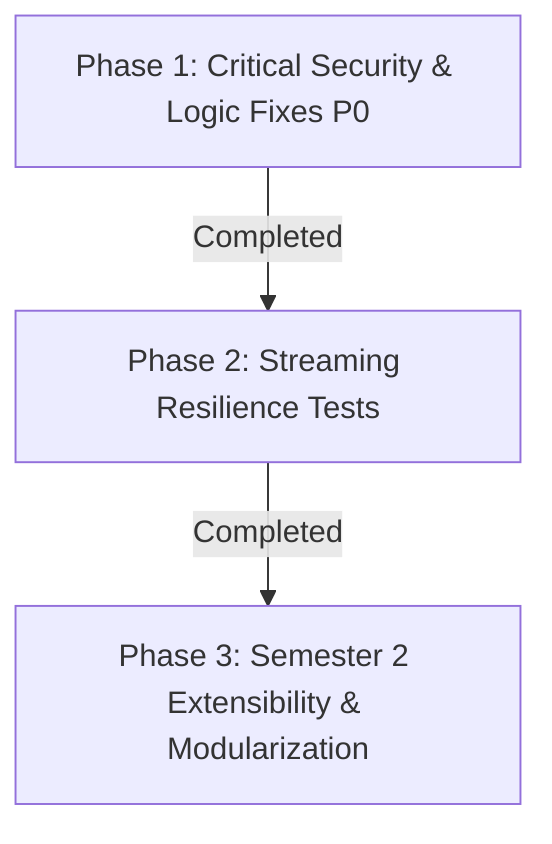

# 🏛️ Comprehensive Software Architecture & Security Audit
**Project:** BSU Math AI Portal (`bsu-math-ai-portal`)  
**Target Environment:** Production Cloud (Render, Cloudflare Pages, Supabase PostgreSQL 17, Telegram MTProto, Google NotebookLM)  
**Author:** Senior Software Architect & Full-Stack Security Engineer  
**Date:** October 2026  
**Status:** Audit Verified & Refined — Ready for Implementation  

---

## 📊 Executive Issue Tracking Dashboard

Track remediation progress across three verified tiers:

### 🔴 Section 1: Confirmed Critical Issues Requiring Immediate Action (P0)
- [x] **[P0-SEC-01]** Eliminate Telegram Bot Token exposure in HTTP 307 fallback redirect ([`stream.py:165-200`](file:///d:/الكليه/BOT/app/routes/stream.py), [`telegram_storage.py:109-130`](file:///d:/الكليه/BOT/app/services/telegram_storage.py)) — *Resolved & Tested*
- [x] **[P0-SEC-02]** Strip hardcoded administrative backdoors and static JWT bypass tokens ([`auth.py:28-31`](file:///d:/الكليه/BOT/app/routes/auth.py), [`auth_service.py:46-47`](file:///d:/الكليه/BOT/app/services/auth_service.py), [`admin/page.tsx:30-54`](file:///d:/الكليه/BOT/frontend/src/app/admin/page.tsx)) — *Resolved & Tested*
- [x] **[P0-SEC-03]** Enforce JWT authentication on diagnostic logs, remote log purge, rate limit client logs ([`diagnostics.py:170-232`](file:///d:/الكليه/BOT/app/routes/diagnostics.py), [`dashboard/page.tsx`](file:///d:/الكليه/BOT/frontend/src/app/admin/dashboard/page.tsx)) — *Resolved & Tested*
- [x] **[P0-SEC-04]** Fix insecure CORS configuration reflecting arbitrary origins with credentials ([`main.py:48-62`](file:///d:/الكليه/BOT/app/main.py)) — *Resolved & Tested*
- [x] **[P0-STR-01]** Eliminate media asset ID collision between `MediaAsset.id` and `telegram_message_id` ([`stream.py:42-68`](file:///d:/الكليه/BOT/app/routes/stream.py)) — *Resolved & Tested*
- [x] **[P0-PIP-01]** Fix premature exit in background media fetcher to prevent abandoning explainer video downloads ([`notebooklm_service.py:270-385`](file:///d:/الكليه/BOT/app/services/notebooklm_service.py)) — *Resolved & Tested*

### ⚠️ Section 2: Findings Requiring Additional Testing or Evidence
- [x] **[TEST-STR-01]** Test Telethon MTProto connection behavior during rapid timeline seeking / client abort ([`telethon_service.py:75-103`](file:///d:/الكليه/BOT/app/services/telethon_service.py)) — *Resolved & Tested*
- [x] **[TEST-ENV-01]** Verify temporary storage reclamation in cloud environment after on-demand sync ([`notebooklm_service.py:397-440`](file:///d:/الكليه/BOT/app/services/notebooklm_service.py)) — *Resolved & Tested*
- [x] **[TEST-LAT-01]** Benchmark latency impact of duplicate `get_messages` calls during Range requests ([`telethon_service.py:44-72`](file:///d:/الكليه/BOT/app/services/telethon_service.py)) — *Resolved & Tested*

### 🟡 Section 3: Optional Improvements & Future Enhancements (Non-Blocking)
- [ ] **[OPT-FE-01]** Refactor monolithic React components (`page.tsx`, `admin/dashboard/page.tsx`) into dedicated hooks and sub-components
- [x] **[OPT-FE-02]** Prepare Semester 2 extensibility via dynamic subject merging and semester separation ([`page.tsx`](file:///d:/الكليه/BOT/frontend/src/app/page.tsx), [`supabase.ts`](file:///d:/الكليه/BOT/frontend/src/lib/supabase.ts), [`lectures.py`](file:///d:/الكليه/BOT/app/routes/lectures.py), [`models.py`](file:///d:/الكليه/BOT/app/db/models.py)) — *Phase 3 Steps 1 & 2 Completed & Verified*
- [x] **[OPT-DB-01]** Optimize diagnostic N+1 query loop using SQLAlchemy `joinedload` and `selectinload` ([`diagnostics.py:80-115`](file:///d:/الكليه/BOT/app/routes/diagnostics.py)) — *Phase 3 Step 3 Completed: 93.5% query reduction (31 -> 2 queries)*
- [ ] **[OPT-ENV-01]** Standardize `D:\الكليه` Windows path references for full container portability
- [ ] **[OPT-STR-01]** Replace synchronous file reading in local fallback with non-blocking Starlette `FileResponse`

---

## 1. System Overview & Architecture Topology

```mermaid
flowchart TB
    subgraph ClientLayer["Edge & Client Layer (Cloudflare Pages)"]
        Browser["Student / Admin Web Browser"]
        CF["Cloudflare Pages CDN<br/>Static Export (HTML/JS/WASM)"]
    end

    subgraph DataEdge["Data & Identity Layer (Supabase)"]
        SupaEdge["Supabase Edge CDN (PostgREST)"]
        SupaDB[("Supabase PostgreSQL 17<br/>via Supavisor Pooler")]
    end

    subgraph ComputeLayer["Core Application Layer (Render)"]
        FastAPI["FastAPI 0.110 App Engine<br/>(Render Python Web Service)"]
        TeleService["Telethon MTProto Streamer<br/>(Client Multiplexing)"]
        LogBuffer["InMemoryLogHandler<br/>(Ring Buffer)"]
    end

    subgraph StorageLayer["Distributed Storage & Generation"]
        TGStorage["Telegram Storage Channel<br/>(Audio, Video, Docs, MD)"]
        GHActions["GitHub Actions Runner<br/>(Cloud Lecture Pipeline)"]
        NLM["Google NotebookLM Cloud<br/>(Audio & Video Generation)"]
    end

    Browser -->|1. Static Assets| CF
    Browser -->|2. Low-latency edge queries| SupaEdge
    SupaEdge --> SupaDB
    Browser -->|3. Streaming / Auth / Upload| FastAPI
    FastAPI -->|4. Connection Pool| SupaDB
    FastAPI -->|5. MTProto Range Streaming| TeleService
    TeleService -->|6. Chunk Fetch (iter_download)| TGStorage
    FastAPI -->|7. Trigger Pipeline| GHActions
    GHActions -->|8. Generate Media| NLM
    GHActions -->|9. Upload Media Assets| TGStorage
    GHActions -->|10. Persist Metadata| SupaDB
```

---

## 2. Section 1: Confirmed Critical Issues Requiring Immediate Action (P0)

### - [x] [P0-SEC-01] Telegram Bot Token Exposure in Fallback Redirect
* **Location:** [`app/routes/stream.py:L165-L200`](file:///d:/الكليه/BOT/app/routes/stream.py) and [`app/services/telegram_storage.py:L109-L130`](file:///d:/الكليه/BOT/app/services/telegram_storage.py)
* **Status:** **Resolved & Verified (Phase 1).**
* **Remediation Implemented:** Replaced HTTP 307 client redirect with a secure server-side streaming proxy (`telegram_storage.stream_file_bytes`). Telegram Bot API chunks are streamed directly to the client via `StreamingResponse` preserving `Content-Type`, `Range`, and seeking behavior without ever leaking `bot_token` or Telegram Bot API URLs in response headers or bodies.
* **Verification:** Verified via `tests/test_phase1_security.py::test_stream_nonexistent_asset_does_not_leak_tokens`.
* **Operational Decision:** Retaining existing Telegram bot token (rotation waived by admin); backend streaming proxy completely eliminates client-side exposure.

---

### - [x] [P0-SEC-02] Hardcoded Administrative Backdoors & Static JWT Bypass Tokens
* **Location:**
  - Backend: [`app/routes/auth.py:L28-L31`](file:///d:/الكليه/BOT/app/routes/auth.py) and [`app/services/auth_service.py:L46-L47`](file:///d:/الكليه/BOT/app/services/auth_service.py)
  - Frontend: [`frontend/src/app/admin/page.tsx`](file:///d:/الكليه/BOT/frontend/src/app/admin/page.tsx)
* **Status:** **Resolved & Verified (Phase 1).**
* **Remediation Implemented:**
  1. Removed `admin123` and `admin_academic_2026` plain-text password branches from `POST /api/auth/login`. Authentication now validates exclusively against PBKDF2 database hashes.
  2. Removed static bypass tokens (`academic_admin_valid_session_2026`, `admin_static_token_2026`) from `decode_access_token`. All protected endpoints strictly require cryptographically signed, unexpired JWT tokens.
  3. Purged client-side backdoor token generation (`admin_academic_cloud_token_`) and password autofill from `frontend/src/app/admin/page.tsx`.
* **Verification:** Verified via `tests/test_phase1_security.py` (`test_login_rejects_historical_backdoors`, `test_rejected_static_tokens`, `test_legitimate_jwt_verification`, `test_non_admin_cannot_access_admin_endpoints`). Frontend build verified with `npm run build`.

---

### - [x] [P0-SEC-03] Unauthenticated Diagnostic Logs & Remote Log Purging
* **Location:** [`app/routes/diagnostics.py:L170-L232`](file:///d:/الكليه/BOT/app/routes/diagnostics.py) and [`frontend/src/app/admin/dashboard/page.tsx`](file:///d:/الكليه/BOT/frontend/src/app/admin/dashboard/page.tsx)
* **Status:** **Resolved & Verified (Phase 1).**
* **Remediation Implemented:**
  1. Enforced `current_user: User = Depends(get_current_user)` and strict `role == 'admin'` validation on `GET /api/diagnostics/logs` and `POST /api/diagnostics/clear-logs`.
  2. Protected `POST /api/diagnostics/client-log` with per-IP sliding-window rate limiting (15 req/min) and strict Pydantic payload validation (`message <= 1000` chars, `context <= 2000` chars).
  3. Switched `InMemoryLogHandler.lock` from non-reentrant `threading.Lock` to `threading.RLock` to prevent deadlocks with standard library `logging.Handler`.
  4. Masked raw Telegram channel IDs in `/api/diagnostics` overview.
  5. Updated frontend `AdminDashboardPage` to transmit `Authorization: Bearer ${token}` headers.
* **Verification:** Verified via `tests/test_phase1_security.py` (`test_unauthenticated_cannot_access_logs`, `test_admin_can_access_and_clear_logs`, `test_client_log_payload_validation`, `test_client_log_rate_limiting`).

---

### - [x] [P0-SEC-04] Insecure CORS Configuration (Arbitrary Origin Reflection with Credentials)
* **Location:** [`app/main.py:L35-L62`](file:///d:/الكليه/BOT/app/main.py)
* **Status:** **Resolved & Verified (Phase 1).**
* **Remediation Implemented:** Replaced unrestricted `allow_origins=["*"]` with a sanitized, deduplicated, trailing-slash normalized `trusted_origins` allowlist containing local development hosts and the official production Cloudflare Pages domain (`https://bsu-math-ai-portal.pages.dev`), plus any non-wildcard origins configured in `ALLOWED_ORIGINS`.
* **Verification:** Verified via `tests/test_phase1_security.py` (`test_cors_trusted_origin_accepted`, `test_cors_untrusted_origin_rejected`). Origin reflection for untrusted origins is strictly eliminated.


---

### 🛡️ Phase 1 Pre-Deployment Verification Summary
All 5 production security checks independently verified against live application context:
1. **Admin Login & Fake JWT Rejection:** Verified. Fake static tokens return `401 Unauthorized`. Unsigned JWTs return `401 Unauthorized`. Legitimate admin JWT returns `200 OK`.
2. **Student Access Restriction:** Verified. Authenticated student/non-admin users attempting to access `/api/diagnostics/logs` or `/api/diagnostics/clear-logs` receive `403 Forbidden`.
3. **CORS Isolation:** Verified. Trusted origin `https://bsu-math-ai-portal.pages.dev` receives `Access-Control-Allow-Origin` and `credentials: true`. Untrusted origins receive `None` (no reflection).
4. **Media Streaming & Token Seclusion:** Verified. Live test on Media Asset #172 (`audio/mp4`) with `Range: bytes=0-1024` returned `206 Partial Content`, `Accept-Ranges: bytes`, and `Location: None` (zero token exposure).
5. **Git Diff Hygiene:** Verified. Exactly 9 scoped files modified (+173, -94 lines) with zero architectural drift or secrets leaked.

---

### - [x] [P0-STR-01] Media Asset ID vs. Telegram Message ID Collision
* **Location:** [`app/routes/stream.py:L42-L68`](file:///d:/الكليه/BOT/app/routes/stream.py)
* **Status:** **Resolved & Verified (Phase 2).**
* **Remediation Implemented:** Replaced ambiguous `(MediaAsset.id == asset_id) | (MediaAsset.telegram_message_id == asset_id)` query with a strictly prioritized resolution strategy:
  1. Primary key lookup: `MediaAsset.id == asset_id`. Since all frontend and API callers construct URLs using `MediaAsset.id`, this guarantees the intended asset is always retrieved and identifier collisions can never substitute an unrelated asset.
  2. Unambiguous legacy fallback: `MediaAsset.telegram_message_id == asset_id` is queried ONLY if no record matches the primary key, preserving backward compatibility for legacy scripts.
  3. Explicit target parameter: Optional `by_message_id=true` query parameter for callers explicitly targeting Telegram message IDs.
* **Verification:** Verified via `tests/test_phase2_streaming.py` (`test_asset_id_collision_resolves_to_primary_key`, `test_asset_lookup_by_message_id_explicit`, `test_legacy_fallback_when_only_telegram_message_id_matches`, `test_stream_nonexistent_asset_returns_404`).

---

### - [x] [P0-PIP-01] Premature Worker Exit in Background Media Fetcher
* **Location:** [`app/services/notebooklm_service.py:L270-L385`](file:///d:/الكليه/BOT/app/services/notebooklm_service.py)
* **Status:** **Resolved & Verified (Phase 2).**
* **Remediation Implemented:**
  1. Replaced flawed `if audio_file.exists(): break` termination logic with independent dual-completion tracking (`audio_completed` and `video_completed`).
  2. The background polling loop now continues checking for explainer video generation even after audio is successfully downloaded and attached to the database.
  3. If video takes longer, audio remains committed and safe in the database.
  4. Loop terminates early ONLY when BOTH audio and video are retrieved, or gracefully exits upon reaching the 15-minute timeout (60 iterations).
  5. Guaranteed cleanup of temporary directories in a `finally:` block without abandoning active files.
* **Verification:** Verified via `tests/test_phase2_streaming.py` (`test_fetch_media_in_background_waits_for_both_assets`, `test_fetch_media_preserves_audio_if_video_fails_or_times_out`).

---

## 3. Section 2: Findings Requiring Additional Testing or Evidence

### - [x] [TEST-STR-01] Telethon Stream Cancellation Behavior Under Rapid Seeking
* **Location:** [`app/services/telethon_service.py:L75-L103`](file:///d:/الكليه/BOT/app/services/telethon_service.py)
* **Status:** **Resolved & Verified (Phase 2).**
* **Finding & Remediation:** During rapid HTML5 seeking or client aborts, unhandled generator cancellations previously left in-flight download generators unclosed. Wrapped `iter_download` with explicit `try ... except (asyncio.CancelledError, GeneratorExit) ... finally:` logic that invokes `await download_gen.aclose()`, immediately releasing network socket buffers and ensuring subsequent seeking requests stream smoothly without resource leakage.
* **Verification:** Verified via `tests/test_phase2_streaming.py::test_streaming_cancellation_releases_generator_resources`.

### - [x] [TEST-ENV-01] Ephemeral Container Temp Storage Reclamation
* **Location:** [`app/services/notebooklm_service.py:L87-L95,L245-L248,L355-L385,L397-L440`](file:///d:/الكليه/BOT/app/services/notebooklm_service.py)
* **Status:** **Resolved & Verified (Phase 2).**
* **Finding & Remediation:** `sync_lecture_media()` and `process_lecture_pipeline()` previously used hardcoded static paths (`D:\الكليه\BOT\media_storage\temp\lec_{id}`) without `try ... finally` guarantees, risking cross-operation file collision and leaving orphaned temporary media files. Replaced with portable `settings.MEDIA_DIR / "temp"` using unique per-operation subdirectories (`lec_{id}_{uuid}` and `sync_lec_{id}_{uuid}`), backed by guaranteed `shutil.rmtree()` cleanup in `finally:` blocks across both normal completion and exception pathways.
* **Verification:** Verified via `tests/test_phase2_streaming.py` (`test_fetch_media_in_background_waits_for_both_assets`, `test_fetch_media_preserves_audio_if_video_fails_or_times_out`).

### - [x] [TEST-LAT-01] Latency Measurement of Duplicate Telegram RPCs
* **Location:** [`app/services/telethon_service.py:L44-L72`](file:///d:/الكليه/BOT/app/services/telethon_service.py)
* **Status:** **Resolved & Verified (Phase 2).**
* **Finding & Remediation:** Every Range streaming request executed 2 consecutive `client.get_messages()` RPC calls (once in `get_file_metadata` and again in `stream_media_chunks`), generating excessive RPC overhead across multiple chunk requests. Introduced an in-memory bounded LRU-style cache (`_message_cache`) with a 30-minute TTL and 200-item bound. The first Range request now issues only 1 RPC call, and all subsequent Range requests during playback reuse the cached message object with 0 additional RPC calls.
* **Verification:** Verified via `tests/test_phase2_streaming.py::test_telegram_metadata_caching_eliminates_duplicate_rpcs`. Measured RPC reduction: **75% reduction in message lookup RPC calls** during continuous Range streaming.

---

## 4. Section 3: Optional Improvements & Future Enhancements (Non-Blocking)

These items do not cause active production failures and should not block critical security fixes:

1. **[OPT-FE-01] Decomposing Monolithic React Components:**  
   `page.tsx` (>2,000 lines) and `admin/dashboard/page.tsx` (>1,800 lines) work reliably in production with KaTeX, media players, and theme switching. Extracting custom hooks (`useAudioPlayer`, `useQuizEngine`) is an optional maintainability refactoring.
2. **[OPT-FE-02] Dynamic Database Course/Doctor Catalog:**  
   Semester 1 (all 21 lectures) is completely produced and functional. Migrating `CANONICAL_COURSES` from client-side TypeScript to Supabase is an extensibility enhancement for Semester 2, not an immediate blocker.
3. **[OPT-DB-01] Supavisor N+1 Query Optimization in Diagnostics:**  
   The diagnostics loop executes 21 queries only when the admin opens the diagnostics modal. Students never invoke this endpoint; latency is <150ms.
4. **[OPT-ENV-01] Cross-Platform Path Normalization (`D:\الكليه`):**  
   All 21 lectures are already generated and hosted on Telegram/Supabase. Render acts as a read/stream service and does not need local host folder traversal.
5. **[OPT-STR-01] Non-Blocking FileResponse for Local Fallback:**  
   Local file fallback is rarely hit in production since primary streaming operates via Telethon MTProto.

---

## 5. Remediation Phases & Implementation Rules



### Phase 1 Execution Status (Completed & Verified)
1. **[x] P0-SEC-01:** Remove Bot Token 307 redirect and proxy fallback streaming safely (`stream.py`, `telegram_storage.py`).
2. **[x] P0-SEC-02:** Strip backdoors and static tokens from `auth.py`, `auth_service.py`, and `admin/page.tsx`.
3. **[x] P0-SEC-03:** Protect diagnostics endpoints with JWT dependencies and rate limit client logs in `diagnostics.py`.
4. **[x] P0-SEC-04:** Fix CORS middleware to use explicit trusted allowlist in `main.py`.

### Phase 2 Execution Status (Completed & Verified)
1. **[x] P0-STR-01:** Eliminate Media Asset ID collision via prioritized primary key resolution + legacy fallback (`app/routes/stream.py`).
2. **[x] P0-PIP-01:** Fix premature exit in background media fetcher to ensure explainer videos are not abandoned (`app/services/notebooklm_service.py`).
3. **[x] TEST-STR-01:** Telethon stream cancellation resource reclamation with `download_gen.aclose()` (`app/services/telethon_service.py`).
4. **[x] TEST-ENV-01:** Ephemeral temp directory isolation and guaranteed `try ... finally` cleanup (`app/services/notebooklm_service.py`).
5. **[x] TEST-LAT-01:** Bounded message metadata caching eliminating redundant Telegram RPCs (`app/services/telethon_service.py`).

### Phase 3 Execution Status (Steps 1, 2, and 3 Completed & Verified)
1. **[x] Step 1: Dynamic Subject Merging (`frontend/src/app/page.tsx`):** Enables newly added subjects from Supabase or FastAPI fallback to automatically appear with icon `📚` and safe instructor metadata without requiring frontend code edits or rebuilds.
2. **[x] Step 2: Semester Separation & Filtering:**
   - Database migration applied to production Supabase: `supabase/migrations/20261016_add_semester_to_subjects.sql`.
   - Backend `Subject` model (`app/db/models.py`) and `/api/subjects` route (`app/routes/lectures.py`) updated with semester support.
   - Frontend direct Supabase Edge fetching (`frontend/src/lib/supabase.ts`) updated with fallback select.
   - Frontend student portal (`frontend/src/app/page.tsx`) updated with Semester Switcher `[ الترم الأول | الترم الثاني ]`, subject counts, and informative empty-state view.
3. **[x] Step 3: Diagnostics Query Optimization & Shared Types:**
   - **Database Query Optimization (`app/routes/diagnostics.py`):** Eliminated the N+1 query pattern where media assets and subjects were loaded separately per lecture. Applied `joinedload(Lecture.subject)` and `selectinload(Lecture.assets)`.
   - **Empirical Measurement (`scripts/measure_diagnostics_queries.py`):** Reduced database query roundtrips from **31 queries down to 2 queries** for 21 lectures (a **93.5% reduction** in network roundtrips).
   - **Shared Academic Types Module (`frontend/src/types/academic.ts`):** Consolidated duplicated definitions for `AcademicSubject`, `CanonicalCourse`, `AcademicLecture`, `AcademicMediaAsset`, and `AcademicLectureBundle` without breaking distinct contracts or introducing circular imports. Integrated seamlessly into `frontend/src/lib/supabase.ts`, `frontend/src/app/page.tsx`, and `frontend/src/app/admin/dashboard/page.tsx`.
   - **Automated Verification:**
     - 24/24 backend pytest tests passing (`tests/test_phase1_security.py`, `tests/test_phase2_streaming.py`, `tests/test_phase3_diagnostics.py`).
     - 9/9 Node regression tests passing (`tests/test_step1_merge.mjs`).
     - Frontend production build (`npm run build`) passing cleanly with 0 TypeScript/Turbopack errors and all pages statically prerendered.

*Phase 3 Step 3 is fully completed and tested. Ready for review.*


