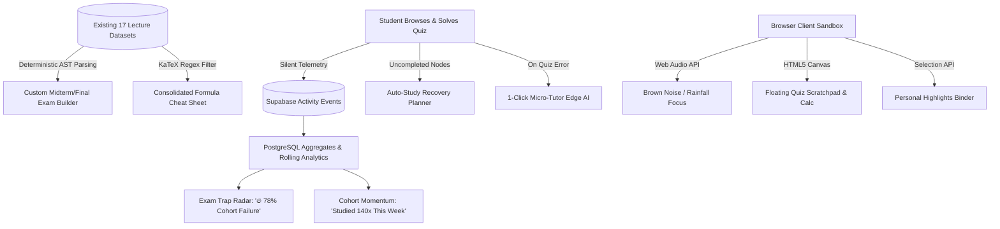
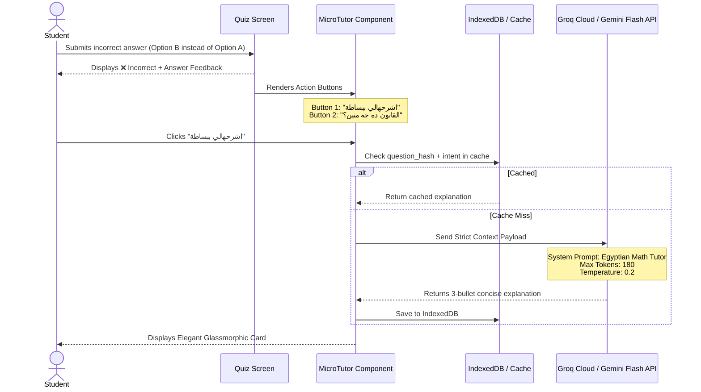

# Autonomous, Zero-Maintenance Ecosystem Specification
## Passive Telemetry, Deterministic Synthesis & Distraction-Free Math Sandbox
**Document Version:** 1.0.0  
**Status:** Approved Architectural Specification  
**Target Platform:** BSU Mathematics AI Portal (`bsu-math-ai-portal.pages.dev`)  
**Core Invariant:** **Zero Ongoing Manual Operations (0-Ops) & Zero Cohort Contribution Dependency**

---

## 1. Executive Vision & Core Philosophy

### 1.1 The Single-Developer Autonomous Ecosystem Invariant
Traditional academic platforms rely on crowd-sourcing, student forum participation, peer notes sharing, or manual daily administrator updates. In university cohort settings, this model invariably degrades: students consume content passively without contributing, forums turn into ghost towns, and manual administrative maintenance creates unsustainable burnout for a solo engineer.

This specification defines the transition of the **BSU Math AI Portal** into a **Self-Sustaining Autonomous Ecosystem**. The platform generates rich engagement, personalized tooling, collective intelligence, and pedagogical scaffolding **strictly from the data already stored** and the **passive behavioral telemetry of students**, requiring:
1. **Zero Daily Human Intervention:** No daily posts, manual updates, or administrative overhead.
2. **Zero Active Student Cooperation:** Students do not need to share notes, submit questions, or talk to each other; their implicit interactions (answers, errors, clicks, reading time) generate systemic value for the entire cohort.
3. **Zero Additional Infrastructure Cost:** Operates within free-tier serverless boundaries (Cloudflare Pages, Supabase Free Tier, Web Audio API, LocalStorage, Groq/Gemini Flash free edge APIs).



---

## 2. Feature Specification 1: Passive Cohort Intelligence & Exam Trap Radar

### 2.1 Concept
Students do not need to flag difficult questions. When students answer quizzes, their attempts are logged to `public.activity_events` (already integrated via `quiz.question_answered`). The system analyzes statistical difficulty across the entire student population and feeds it back into the UI in real time.

### 2.2 Technical Implementation

#### A. Data Model & Aggregation View
```sql
-- Materialized View or Standard View for Question Difficulty
CREATE OR REPLACE VIEW public.v_question_cohort_stats AS
SELECT
    (payload->>'question_id')::text AS question_id,
    (payload->>'lecture_id')::int AS lecture_id,
    COUNT(*) AS total_attempts,
    COUNT(*) FILTER (WHERE (payload->>'is_correct')::boolean = false) AS incorrect_attempts,
    ROUND(
        (COUNT(*) FILTER (WHERE (payload->>'is_correct')::boolean = false)::numeric / 
        NULLIF(COUNT(*), 0)::numeric) * 100, 1
    ) AS failure_rate_pct
FROM public.activity_events
WHERE event_type = 'quiz.question_answered'
GROUP BY payload->>'question_id', payload->>'lecture_id';
```

#### B. Dynamic UI "Exam Trap" Badge
- **Condition:** If `total_attempts >= 8` AND `failure_rate_pct >= 65.0%`.
- **UI Treatment:** Displays a prominent animated amber/red badge above the question stem:
  - Label: `🔥 فخ امتحانات (غلط فيه {failure_rate_pct}% من الدفعة)`
  - Psychological Effect: Heightens student attention and vigilance during revision without student-to-student chat.

#### C. Dedicated View: "Toughest Cohort Hurdles" (`CohortHurdlesModal.tsx`)
- Queries the top 20 questions across all subjects with the highest `failure_rate_pct`.
- Allows students to practice an "Ultimate Pitfalls Gauntlet" prior to final exams.

#### D. Live Cohort Momentum Meter
- Computes aggregate rolling 7-day engagement on lecture cards:
  ```typescript
  // Displayed passively on LectureCard.tsx
  "🔥 اتفرمت 142 مرة هذا الأسبوع" | "⚡ الأكثر نشاطاً اليوم بين زملائك"
  ```
- Generated via `SELECT lecture_id, COUNT(*) FROM activity_events WHERE created_at >= NOW() - INTERVAL '7 days' GROUP BY lecture_id`.

---

## 3. Feature Specification 2: Deterministic Synthesis Tools

The platform already stores rich multimodal assets for all lectures in `public.lectures` (Zaytouna Markdown summaries, 5-question quizzes, flashcards, audio, video). With zero server compute, the client can synthesize these assets into high-leverage study suites.

### 3.1 Custom Exam Builder & Mock Exam Simulator (`CustomExamBuilder.tsx`)

#### A. Architecture & Workflow
1. **Configuration Screen:**
   - **Subject Selection:** (e.g., تدريس مصغر or تكنولوجيا التعليم).
   - **Scope:** Multi-select lectures (e.g., Lectures 1 through 6).
   - **Question Volume:** 10, 20, or 30 questions.
   - **Exam Mode:** Strict Simulation (Timed, no instant feedback) vs. Practice Mode (Instant explanation).
2. **Algorithmic Sampling:**
   - Client pools all `quiz` objects from the selected lectures.
   - Applies the **Fisher-Yates Shuffle Algorithm** with a non-repeating reservoir to select $K$ questions uniformly across the target lectures.
3. **Execution State Machine:**
   ```
   [Configuring] ──> [In_Progress (Countdown Timer Active)] ──> [Review_Sheet] ──> [Graded]
   ```
4. **Diagnostic Post-Mortem Report:**
   Upon submission, the engine categorizes mistakes by lecture origin:
   - Score: `16 / 20 (80%) - ممتاز`
   - Diagnostic Vector:
     - *المحاضرة 1: 4/4 (100%) - متقن*
     - *المحاضرة 2: 1/4 (25%) - ⚠️ نقطة ضعف حرجة*
   - Direct CTA: *"ننصحك بمراجعة بطاقات استذكار المحاضرة الثانية لتدارك القصور."*

### 3.2 Auto-Cheat Sheet / Unified Formula Aggregator (`FormulaAggregator.ts`)

#### A. Processing Pipeline
1. Ingests raw `summary_md` ("الزتونة") for all lectures of a chosen course.
2. Runs AST / Regular Expression extraction for:
   - **Display Math:** `/\$\$([\s\S]*?)\$\$/g`
   - **Inline Math:** `/\$([^\$\n]+?)\$/g`
   - **Theorem / Law Blocks:** Lines starting with `### قانون`, `### تعريف`, `### نظرية`.
3. Normalizes and deduplicates math expressions using string token canonicalization.
4. Generates an interactive, categorized **"One-Page Course Formula Sheet"**:
   - Filter by Lecture.
   - Instant Search for symbols or keywords (e.g., `مصفوفة`, `تفاضل`, `جاذبية`).
   - Copy KaTeX LaTeX code to clipboard.
   - Fully optimized for printing via CSS `@media print` (black-and-white, zero backgrounds, clean page breaks).

---

## 4. Feature Specification 3: Automated Recovery Planner ("Clear My Backlog")

### 4.1 Problem Formulation
Students frequently suffer from procrastination or miss classes due to personal circumstances. Facing 17+ lectures causes decision paralysis. The platform already knows the student's uncompleted lectures via their LocalStorage progress cache and `profiles.id`.

### 4.2 Algorithm & Pacing Contract (`AutoStudyPlanner.ts`)

#### A. Inputs
- Target Duration $D \in [2, 14]$ days.
- Daily Available Window $H \in [30, 180]$ minutes.
- Selected Course ID.

#### B. Pacing Distribution Algorithm
1. Identifies all uncompleted lectures $\{L_1, L_2, \dots, L_m\}$ where `completed !== true`.
2. Assigns deterministic time weights based on modality:
   - Fast Lane: Read Zaytouna (10 min) + Solve Quiz (8 min) = 18 min/lecture.
   - Standard Lane: Listen to Audio (25 min) + Solve Quiz (8 min) = 33 min/lecture.
   - Comprehensive Lane: Watch Video (35 min) + Study Guide (10 min) + Quiz (8 min) = 53 min/lecture.
3. Distributes lectures across $D$ days to match the daily budget $H$, packing higher-priority foundational lectures first.
4. Outputs an interactive Daily Checklist:
   ```markdown
   📅 اليوم 1: استمع لبودكاست المحاضرة 2 + حل كويز المحاضرة 3 (المطلوب: 45 دقيقة)
   📅 اليوم 2: راجع ملخص المحاضرة 4 + حل بنك أسئلة المحاضرة 5 (المطلوب: 35 دقيقة)
   ```
5. **Reward Contract:** Checking off all tasks for the day awards a **`+50 XP Backlog Crusher`** bonus, updating the global streak.

---

## 5. Feature Specification 4: Distraction-Free Math Sandbox & Focus Environment

To prevent students from leaving the platform to open external calculators, YouTube background tracks, or note-taking apps, the browser tab becomes a self-contained productivity sandbox.

### 5.1 Zero-Bandwidth Synthetic Focus Sound Engine (`soundEngine.ts`)

#### A. Web Audio API Procedural Noise Synthesis
Rather than streaming heavy MP3 ambient files over mobile bandwidth, the client synthesizes soothing background noise procedurally using the native Web Audio `AudioContext`.

```typescript
// Procedural Brownian Noise Generator (Zero-Bandwidth)
export function startBrownNoise(ctx: AudioContext, gainNode: GainNode) {
  const bufferSize = 4096;
  let lastOut = 0.0;
  const scriptNode = ctx.createScriptProcessor(bufferSize, 1, 1);
  scriptNode.onaudioprocess = (e) => {
    const output = e.outputBuffer.getChannelData(0);
    for (let i = 0; i < bufferSize; i++) {
      const white = Math.random() * 2 - 1;
      output[i] = (lastOut + (0.02 * white)) / 1.02;
      lastOut = output[i];
      output[i] *= 3.5; // Gain compensation
    }
  };
  scriptNode.connect(gainNode);
  gainNode.connect(ctx.destination);
  return scriptNode;
}
```

#### B. Integrated Pomodoro Timer
- 25-minute study intervals followed by 5-minute cooldown chimes.
- Seamlessly running in the background during reading or quiz solving.
- Awards **`+15 XP Focus Session`** upon timer completion.

### 5.2 Floating In-Quiz Scratchpad & Scientific Calculator (`MathScratchpad.tsx`)

#### A. Touch/Stylus Drawing Canvas
- A togglable floating overlay button appearing in the quiz interface.
- Lightweight HTML5 Canvas supporting finger, mouse, or stylus pen input.
- Real-time stroke smoothing with Clear, Undo, and Color options.
- Eliminates the need for physical scrap paper when solving math steps.

#### B. Embedded Floating Math Calculator
- Clean drawer containing standard scientific functions: $\sin, \cos, \tan, \sqrt{x}, x^y, \log, \pi, e$.
- Evaluates mathematical expressions with instant syntax validation without leaving the test viewport.

### 5.3 Client-Side Highlight Reel / Student Notebook (`StudentBinder.tsx`)

- Allows selecting any text passage in the "الزتونة" lecture summary.
- A floating tooltip appears: `[📌 حفظ في كشكولي]`.
- Stores highlights in `localStorage['bsu_math_notebook_v1']` organized by subject and lecture.
- Provides a dedicated "كشكول مراجعاتي" (My Binder) view where the student sees all their saved formulas and insights consolidated in one place.

---

## 6. Feature Specification 5: Zero-Prompt Contextual Micro-Tutor (Free Edge AI)

### 6.1 Design Philosophy: Deterministic Micro-Prompts vs. Open Chatbots
Open chat interfaces suffer from multiple systemic flaws in student deployments:
- High token burn and unpredictable quota exhaustion.
- Hallucinations or off-topic conversational drifting.
- Students don't know what prompts to ask.

The **Micro-Tutor** replaces open chat with **One-Click Targeted Explainers** embedded directly beneath incorrect quiz answers.

### 6.2 Architecture & Flow


### 6.3 Prompt Payload Contract

```json
{
  "system": "أنت مساعد تدريس رياضيات جامعي مصري ذكي ومختصر جداً. اشرح للطالب سبب الخطأ بالعامية المصرية الراقية في 3 نقاط محددة وبسيطة، مستخدماً لغة مباشرة وبدون مقدمات أو اختتام.",
  "context": {
    "course": "تكنولوجيا التعليم والتحول الرقمي",
    "lecture": "المحاضرة الثالثة: مستحدثات تكنولوجيا التعليم",
    "question": "ما الفرق بين الواقع المعزز (AR) والواقع الافتراضي (VR)؟",
    "student_choice": "الواقع المعزز يعزل المستخدم تماماً عن بيئته الحقيقية",
    "correct_choice": "الواقع الافتراضي يعزل المستخدم، بينما المعزز يضيف عناصر رقمية للبيئة الواقعية"
  },
  "max_tokens": 180,
  "temperature": 0.2
}
```

### 6.4 Cost & Quota Economics
- Model: **Groq LLaMA 3.3 70B** or **Google Gemini 2.5 Flash Free Tier**.
- Latency: $< 800\text{ms}$.
- Token Usage: $\approx 220$ tokens per call.
- Cohort Cache: Identical questions answered incorrectly across students share the IndexedDB or local edge cache, slashing remote API calls by $> 75\%$.
- Monthly Cost: **$0.00 (100% Free Tier Eligible)**.

---

## 7. Implementation Roadmap & Technical Milestones

| Phase | Module | Target Deliverable | Effort |
| :--- | :--- | :--- | :--- |
| **Phase 1** | **Deterministic Synthesis** | Mock Exam Simulator (`CustomExamBuilder.tsx`) & Auto Formula Aggregator (`FormulaAggregator.ts`) | 1 Day |
| **Phase 2** | **Passive Telemetry** | PostgreSQL view `v_question_cohort_stats` + Dynamic "Exam Trap" badges in `QuizComponent.tsx` | 0.5 Day |
| **Phase 3** | **Distraction-Free Sandbox** | Web Audio Brown Noise synthesis in `soundEngine.ts` + Floating Scratchpad Canvas | 1 Day |
| **Phase 4** | **Recovery Planner** | Backlog Crusher algorithm & interactive daily plan modal (`AutoStudyPlanner.ts`) | 0.5 Day |
| **Phase 5** | **Zero-Prompt Micro-Tutor** | Groq/Gemini Flash edge function with deterministic 1-click mistake explainer | 1 Day |

---

## 8. Summary of Systemic Advantages

1. **Self-Sustaining Collective Intelligence:** The platform becomes smarter as more students use it, without any student realizing they are contributing to cohort analytics.
2. **Resilience to Inactivity:** Even during quiet periods, the Mock Exam Builder, Formula Sheets, Focus Engine, and Scratchpad provide standalone utility.
3. **Zero Maintenance Burden:** The entire system relies on static lecture content and automatic database row insertions. The developer does not need to author new weekly content.
