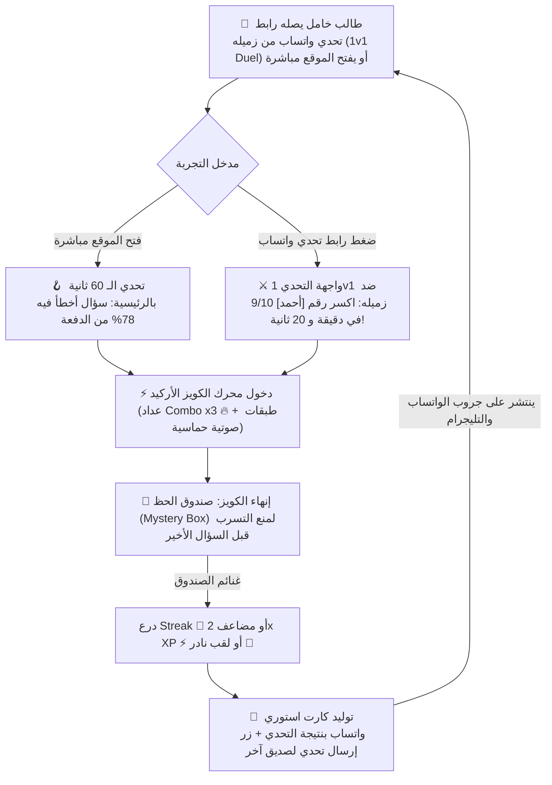

# 🧠 الخطة الاستراتيجية الشاملة لتطوير ميزات الجذب النفسي ومحاربة التشتت (Gen-Z Engagement & Anti-Brainrot Master Plan)
*نسخة محدثة ومُعاد ترتيب أولوياتها بناءً على البيانات والأرقام الفعلية للإنتاج (تحديث 7 نوفمبر 2026)*

> [!IMPORTANT]
> **الهدف الاستراتيجي لهذه الوثيقة**: تحويل منصة **BSU Math AI Portal** من مجرد "أرشيف محاضرات ذكي" إلى **"بيئة مذاكرة إدمانية إيجابية"** مصممة خصيصاً لطبيعة انتباه جيل **Gen Z**.
> تم **إعادة ترتيب أولويات هذه الخطة بالكامل** بناءً على التحليل الدقيق لسلوك **208 طالب وطالبة حقيقيين** و **413 حدث تفاعل فعلي** على السيرفر الحي، لضمان استثمار جهد التطوير في الأماكن التي يقضي فيها الطلاب معظم وقتهم حالياً.

---

## 📈 الدوافع الواقعية لإعادة الترتيب (Production Data Insights - Nov 7, 2026)

قبل استعراض الترتيب الجديد، هذه هي الحقائق الأربع التي فرضت تغيير الأولويات:

1. **الكويزات هي الحصان الرابح للمنصة (70.5% من إجمالي النشاط)**:
   - تم تسجيل **291 إجابة لسؤال كويز** مقابل 74 قراءة ملخص و 28 استماع بودكاست/فيديو.
   - لكن هناك مشكلة سلوكية واضحة: من أصل 291 إجابة، **7 مرات فقط** تم فيها إنهاء الكويز حتى النهاية (`quiz.finished`)! الطلاب يبدأون الكويز ويحلون 3-4 أسئلة ثم يتشتتون، لأن شاشة النهاية لا تقدم مكافأة غير متوقعة تحفزهم على الإكمال.
   - *القرار*: **نظام الأركيد والكومبو الفوري داخل الكويز + صندوق الحظ عند إنهاء الكويز** يجب أن يكونا على رأس الأولويات.

2. **إشعارات الويب شبه معطلة (4 مشتركين فقط من أصل 208 = 1.9%)**:
   - لا يمكننا الاعتماد حالياً على إرسال إشعار للمتصفح لإيقاظ الـ 180+ طالباً الخاملين لأنهم لم يعطوا الإذن للمتصفح.
   - القناة الحقيقية الوحيدة المتاحة للوصول إلى هؤلاء الطلاب هي **جروبات الواتساب والتليجرام الخاصة بالدفعة**.
   - *القرار*: ميزة **"تحدي صاحبك 1v1" برابط مباشر ورسالة واتساب مشوقة + كارت الاستوري** قفزت للمركز الثاني فوراً لأنها آلية الانتشار الفيروسي الوحيدة المتاحة حالياً.

3. **وجود 180+ طالباً مسجلين لكنهم لم يتجاوزوا عتبة البدء (Activation Barrier)**:
   - سجل 112 طالباً في يوم الانطلاق، ولدينا الآن 208 طلاب، لكن النواة النشطة يومياً حوالي 20-25 طالباً.
   - *القرار*: وضع **"تحدي الـ 60 ثانية"** مباشرة في واجهة الصفحة الرئيسية يسحب الطالب من مجرد متفرج إلى متفاعل بضغطة زر واحدة بدون الحاجة للبحث وسط 11 مادة و 58 محاضرة.

4. **اكتساح المواد النظرية والمفاهيمية (فلسفة وتاريخ رياضيات & نظرية عدد)**:
   - المحاضرات 9 و 10 و 11 (فلسفة وتاريخ رياضيات) حققت وحدها **280 تفاعلاً**، تليها نظرية العدد (46 تفاعلاً).
   - الطلاب يستعينون بالمنصة بشكل أساسي لحفظ ومراجعة المواد التي تحتوي على قوانين وألغام امتحانية وتواريخ.
   - *القرار*: تقديم **وضع طوارئ الامتحان (Panic Mode)** و **وضع الريلز (Math Reels)** لدعم هذه المواد قبل امتحانات الميدتيرم.

---

## 📊 مصفوفة ترتيب الأولويات المحدثة (Data-Driven Priority Matrix)

تم ترتيب المميزات الـ **11** بناءً على الأثر المباشر على الأرقام الحقيقية المذكورة أعلاه:

| الترتيب الجديد | الميزة (Feature) | الدافع من واقع بيانات الإنتاج | الأثر المتوقع | تعقيد التنفيذ | المرحلة (Sprint) |
| :---: | :--- | :--- | :---: | :---: | :---: |
| **1 🥇** | **نظام الكومبو والأركيد داخل الكويز (Quiz Arcade Combo `x3 🔥`)** | مضاعفة متعة النشاط الذي يقضي فيه الطلاب 70% من وقتهم حالياً | 🔥🔥🔥🔥🔥 (فوري وحاسم) | منخفض | **Sprint 1 (Quiz Doubling & Viral)** |
| **2 🥈** | **تحدي صاحبك 1 ضد 1 + كارت الاستوري (1v1 Quiz Duel & WhatsApp Story)** | القناة البديلة لإشعارات الويب لإيقاظ 180+ طالباً خاملين عبر واتساب | 🔥🔥🔥🔥🔥 (انتشار فيروسي) | متوسط | **Sprint 1 (Quiz Doubling & Viral)** |
| **3 🥉** | **تحدي الـ 60 ثانية اليومي بالرئيسية (Daily Micro-Hook 🪝)** | كسر حاجز الكسل لـ 208 طالباً بمجرد فتح الصفحة الرئيسية | 🔥🔥🔥🔥 (تنشيط يومي) | منخفض | **Sprint 1 (Quiz Doubling & Viral)** |
| **4** | **صندوق الحظ والمكافآت عند إنهاء الكويز (Mystery Loot Box 🎁)** | علاج تسرب الطلاب قبل إكمال الكويز (حُلّ 291 سؤالاً واكتمل 7 كويزات فقط!) | 🔥🔥🔥🔥 (رفع إكمال الكويز) | متوسط | **Sprint 2 (Retention & Panic Core)** |
| **5** | **وضع طوارئ ليلة الامتحان (Panic / Crunch Mode 🚨)** | خدمة الإقبال الهائل على مواد الامتحانات (فلسفة وتاريخ رياضيات ونظرية عدد) | 🔥🔥🔥🔥 (للميدتيرم) | متوسط | **Sprint 2 (Retention & Panic Core)** |
| **6** | **درع الـ Streak والإنقاذ (Streak Freeze 🧊)** | حماية النواة الصلبة من الطلاب النشطين (مثل ملاك وعبد الرحمن أصحاب 4 أيام متتالية) | 🔥🔥🔥🔥 (حماية السوبر يوزرز) | منخفض - متوسط | **Sprint 2 (Retention & Panic Core)** |
| **7** | **وضع الريلز التعليمية (Math Reels / Swipe Mode 📱)** | تصفح سريع وسلس لمفاهيم وتعاريف المواد النظرية الأكثر زيارة | 🔥🔥🔥 | متوسط | **Sprint 3 (Deep Experience)** |
| **8** | **تحفيز إشعارات الويب بذكاء (Smart Push Opt-In Banner 🔔)** | رفع نسبة المشتركين في الإشعارات من 1.9% (4 طلاب فقط) إلى 30%+ | 🔥🔥🔥 | منخفض | **Sprint 3 (Deep Experience)** |
| **9** | **نبض الدفعة الحي (Live Study Room & Ambient Presence 👥)** | استغلال ذروة الـ 131 تفاعلاً بالأمس لإشعار الطالب أن الدفعة تذاكر معه الآن | 🔥🔥🔥 | متوسط | **Sprint 3 (Deep Experience)** |
| **10** | **البودكاست التفاعلي المتزامن والشخبطة (Visual Synced Podcast & Scratchpad 🎧)** | تطوير تجربة الاستماع (سُجلت 28 جلسة فقط مقارنة بـ 291 في الكويز) | 🔥🔥 | متوسط | **Sprint 4 (Polish & Multiplayer)** |
| **11** | **رادار تركزات المدرج التشاركي (Crowd-Sourced "Doctor Said" Upvotes 🎯)** | توثيق تركزات الدكاترة في قاعات المحاضرات بتصويت الدفعة | 🔥🔥 | متوسط - عالي | **Sprint 4 (Polish & Multiplayer)** |
| **12** | **الهوية البصرية وثيمات المستويات (Dynamic Study Themes & Auras 🎨)** | تخصيص مظهر الموقع لأصحاب المستويات العالية (Level 5+) | 🔥🔥 | منخفض - متوسط | **Sprint 4 (Polish & Multiplayer)** |

---

## 🗺️ المخطط المعماري المحدث لتدفق تجربة الطالب (Data-Driven Flow)

---

## 🚀 التفصيل الهندسي والنفسي للميزات (مرتبة حسب الأولويات الجديدة)

---

### 🥇 الميزة 1: نظام الكومبو والأركيد داخل الكويز — (Quiz Arcade Combo `x3 🔥`)
* **الترتيب السابق**: 2 ⬅️ **الترتيب الجديد**: **1** (الأولوية القصوى المطلقة).
* **لماذا أصبحت رقم 1؟**: لأن أرقام الإنتاج أثبتت أن **70.5% من كل نقرات الطلاب** على الموقع تذهب إلى الكويزات (291 إجابة). تحسين هذه التجربة فوراً بمؤثرات أركيد سريعة سيشعر به 100% من الطلاب المتفاعلين من أول دقيقة!
* **التفاصيل النفسية والتنفيذية**:
  - **عداد الكومبو (`Combo Meter`)**: عند الإجابة على سؤالين متتاليين صح من المحاولة الأولى، يبدأ العداد: `x2` ⬅️ `x3 🔥` ⬅️ `x4 ⚡` ⬅️ `x5 👑 UNSTOPPABLE`.
  - **المؤثرات الصوتية (`Pitch Shift`)**: استخدام `Web Audio API` لتوليد نغمات موسيقية تتصاعد نغمتها مع كل إجابة صحيحة متتالية (`C5 -> D5 -> E5 -> G5 -> C6`).
  - **اهتزاز الشاشة المبهج (`Micro Screen-Shake`)** مع وميض ذهبي خفيف عند الوصول لـ `x5`، مما يرفع الأدرينالين ويمنع التشتت.
* **الملف المستهدف**: [LectureQuizEngine.tsx](file:///d:/الكليه/BOT/frontend/src/components/lecture/LectureQuizEngine.tsx).

---

### 🥈 الميزة 2: تحدي صاحبك (1v1 Quiz Duel ⚔️) + كارت الاستوري (Story Card 📸)
* **الترتيب السابق**: 3 ⬅️ **الترتيب الجديد**: **2**.
* **لماذا قفزت للمركز الثاني؟**: لأن فحص الإنتاج كشف أن لدينا **4 مشتركين فقط في إشعارات الويب**. هذا يعني أن السيرفر عاجز تماماً عن إرسال تنبيهات لـ 204 طالب! الوسيلة الوحيدة لإيقاظ الطلاب الخاملين وجلبهم للمنصة هي أن يرسل لهم زملاؤهم النشطون (مثل ملاك أو نسمة أو عبد الرحمن) روابط تحدي مباشرة عبر الواتساب والتليجرام.
* **التفاصيل النفسية والتنفيذية**:
  - عند نهاية الكويز: زر ذهبي **"⚔️ اتحدى صاحبك في الكويز ده"**.
  - يتم توليد رابط بدون الحاجة لقاعدة بيانات:
    `?id=9&duel_by=Malak&score=9&total=10&time=78&sig=...`
  - رسالة جاهزة للنسخ والمشاركة بنقرة واحدة:
    > *"⚔️ [ملاك] قفلت كويز فلسفة الرياضيات 9/10 في دقيقة و 18 ثانية! تقدر تكسر رقمها؟ ادخل التحدي: [الرابط]"*
  - الطرف الآخر عندما يفتح الرابط يظهر له تايمر تنازلي وبانر: *"أنت في مواجهة ضد [ملاك] — الهدف: كسر رقم 01:18"*.
  - زر **"📸 تحميل كارت الاستوري (9:16)"** لتنزيل صورة مصممة بدارك مود فخم لحفظها على ستوري الواتساب.

---

### 🥉 الميزة 3: تحدي الـ 60 ثانية بالصفحة الرئيسية — (Daily Micro-Hook 🪝)
* **الترتيب السابق**: 1 ⬅️ **الترتيب الجديد**: **3**.
* **الدافع من بيانات الإنتاج**: هناك 180+ طالباً دخلوا المنصة وسجلوا أسماءهم لكن لم يكملوا أي كويز. وجود 11 مادة و 58 محاضرة يصيب الطالب المبتدئ بالحيرة. هذا الكارت في الواجهة الرئيسية يزيل الحيرة تماماً.
* **التفاصيل النفسية والتنفيذية**:
  - كارت بارز أعلى [page.tsx](file:///d:/الكليه/BOT/frontend/src/app/page.tsx):
    `🔥 سؤال اليوم في الدفعة • 79% أخطأوا فيه أمس!`
  - يستعين بـ `v_question_cohort_stats` لاختيار السؤال الأكثر إثارة للجدل أو سؤال يومي موحد لجميع الطلاب.
  - الإجابة بضغطة واحدة من الرئيسية مباشرة دون فتح صفحة المحاضرة. إذا أجاب صح يحصل على `+25 XP` وزر *"أكمل باقي الكويز (دقيقتين) ←"*.

---

### 4️⃣ الميزة 4: صندوق الحظ عند إنهاء الكويز — (Mystery Loot Box 🎁)
* **الترتيب السابق**: 7 ⬅️ **الترتيب الجديد**: **4** (قفزة كبيرة للأمام!).
* **لماذا تم تقديمها؟**: كشفت الأرقام أن الطلاب جاوبوا **291 سؤالاً** ولكن أنهوا الكويز **7 مرات فقط**! الطلاب يتركون الكويز في المنتصف لعدم وجود جائزة في النهاية.
* **التفاصيل النفسية والتنفيذية**:
  - عند حل السؤال الأخير: أنيميشن صندوق ثلاثي الأبعاد يهتز ويفتح بانفجار Confetti.
  - مكافآت عشوائية (Variable Rewards):
    - `+50 XP` إضافية أو `Double XP Boost ⚡` لمدة 30 دقيقة.
    - **درع تجميد الـ Streak (`Streak Freeze 🧊`)**.
    - **ألقاب نادرة** تظهر في لوحة الشرف (مثل *"قاهر المتراكم 🔥"*، *"برنس التحليلي"*).
  - هذا الصندوق سيجعل نسبة إكمال الكويزات تقفز فوراً لأن الطالب يريد معرفة "ماذا سيخرج من الصندوق اليوم؟".

---

### 5️⃣ الميزة 5: وضع طوارئ ليلة الامتحان — (Panic / Crunch Mode 🚨)
* **الترتيب السابق**: 5 ⬅️ **الترتيب الجديد**: **5** (تم الحفاظ على أولويتها العالية).
* **الدافع من بيانات الإنتاج**: أثبتت البيانات أن الطلاب يركزون بشكل كاسح على المواد النظرية والمفاهيمية (فلسفة وتاريخ الرياضيات حققت 280 تفاعلاً، ونظرية عدد 46 تفاعلاً). ومع اقتراب امتحانات الميدتيرم في شهر نوفمبر، هذا الوضع سيكون المنقذ الأول للدفعة.
* **التفاصيل النفسية والتنفيذية**:
  - زر طوارئ أحمر أنيق: **"🚨 وضع ليلة الامتحان (الزتونة)"**.
  - يستخلص فورياً:
    1. **أهم ألغام الدفعة (Top Traps)**: الأسئلة الأكثر خطأً في المادة.
    2. **ورقة القوانين والتعاريف الشاملة (Formula Cheat-Sheet)**: استخلاص كل معادلات KaTeX والتعاريف المؤطرة في صفحة واحدة قابلة للطباعة أو المراجعة السريعة في المواصلات.
    3. **كويز الميدتيرم السريع (Speed Blitz)**: 10 أسئلة مجمعة من كل محاضرات المادة بتايمر 5 دقائق.

---

### 6️⃣ الميزة 6: درع الـ Streak والإنقاذ — (Streak Freeze 🧊)
* **الترتيب السابق**: 8 ⬅️ **الترتيب الجديد**: **6** (تم تقديمها لحماية السوبر يوزرز).
* **الدافع من بيانات الإنتاج**: لدينا بالفعل طلاب بنوا سلاسل أيام متتالية (مثل `Malak Fathey` بـ 4 أيام، و `عبد الرحمن` بـ 3 أيام). في علم النفس، إذا غاب الطالب يوماً وخسر الـ Streak بتاعه، يصاب بإحباط حاد وقد ينقطع عن المنصة تماماً.
* **التفاصيل النفسية والتنفيذية**:
  - منح درع تجميد مجاني (`Streak Freeze 🧊`) لكل طالب يكمل 3 كويزات، أو من صندوق الحظ.
  - إذا غاب الطالب يوماً، يتم استهلاك الدرع تلقائياً لحفظ الـ Streak، مع رسالة ترحيبية: *"🧊 درعك الجليدي أنقذ سلسلة مذاكرتك أمس!"*.

---

### 7️⃣ الميزة 7: وضع الريلز التعليمية — (Math Reels / Swipe Mode 📱)
* **الترتيب السابق**: 4 ⬅️ **الترتيب الجديد**: **7**.
* **الدافع**: رغم أهميتها النفسية، إلا أن الكويزات هي الأولوية الأولى الآن. وضع الريلز سيكون الخطوة التالية لتحويل الـ 74 قراءة لملخصات المحاضرات إلى قراءات ممتعة بأسلوب كروت التيك توك الرأسية (Vertical Swipe).
* **الملف المستهدف**: `frontend/src/components/lecture/MathReelsViewer.tsx`.

---

### 8️⃣ الميزة 8: تحفيز إشعارات الويب بذكاء — (Smart Push Opt-In Banner 🔔)
* **ميزة جديدة مضافة بناءً على كشف الإنتاج**:
* **الدافع**: 4 مشتركين فقط = كارثة تسويقية للمنصة. المتصفح يظهر نافذة باهتة يرفضها 98% من الطلاب تلقائياً.
* **الحل**:
  - إضافة بانر داخلي شيك ومرح في الصفحة الرئيسية يوضح الفائدة قبل طلب إذن المتصفح:
    > *"🔔 حابب ننبهك لما تنزل محاضرة جديدة أو لو الـ Streak بتاعك هيضيع؟ اضغط هنا لتفعيل التنبيهات الذكية!"*
  - وبذلك نقفز بالمشتركين من 4 إلى 50+ طالب في أيام معدودة.

---

### 9️⃣ الميزة 9: نبض الدفعة الحي — (Live Study Room & Ambient Presence 👥)
* **الترتيب السابق**: 9 ⬅️ **الترتيب الجديد**: **9**.
* **الدافع**: أمس كان هناك 131 تفاعلاً، واليوم طلاب كانوا يذاكرون في السابعة صباحاً والواحدة ظهراً. إظهار شارة خضراء خفيفة (`🟢 6 طلاب بيذاكروا المحاضرة دي دلوقتي`) عبر Supabase Realtime سيعطي إحساساً قوياً بالمجتمع والتنافس.

---

### 🔟 الميزة 10: البودكاست التفاعلي المتزامن والشخبطة — (Visual Synced Audio & Scratchpad 🎧)
* **الترتيب السابق**: 6 ⬅️ **الترتيب الجديد**: **10** (تراجعت لأن البودكاست لم يحقق سوى 28 تفاعلاً مقارنة بـ 291 في الكويزات، فالأولوية لدعم ما يحبه الطلاب أولاً).

---

### 1️⃣1️⃣ الميزة 11: رادار تركزات المدرج التشاركي — (Crowd-Sourced "Doctor Said" Upvotes 🎯)
* **الترتيب السابق**: 10 ⬅️ **الترتيب الجديد**: **11**.
* تحتاج لتواجد الطلاب في المدرج وتصويتهم الحي أثناء المحاضرات.

---

### 1️⃣2️⃣ الميزة 12: الهوية البصرية وثيمات المستويات — (Dynamic Study Themes & Auras 🎨)
* **الترتيب السابق**: 11 ⬅️ **الترتيب الجديد**: **12**.
* ميزة جمالية ممتعة لكنها تأتي بعد ضمان انتشار وثبات المنصة.

---

## 🗓️ خارطة الطريق المحدثة للدفعات (Updated Phased Roadmap)

بناءً على أولويات الأرقام والواقع الميداني، هذا هو التقسيم المثالي للدفعات:

### 🚀 الدفعة الأولى (Sprint 1) — "مضاعفة الكويزات والانتشار الفيروسي":
> **الهدف**: استغلال الـ 291 إجابة الحالية ومضاعفتها + إيقاظ الـ 180+ طالباً الخاملين عبر جروبات الواتساب.
1. **نظام الكومبو والأركيد (`Combo x3 🔥` + المؤثرات الصوتية)** داخل محرك الكويز.
2. **تحدي صاحبك 1v1 (`Quiz Duel`) + مولد بطاقة الاستوري (`Story Card`) للواتساب**.
3. **تحدي الـ 60 ثانية اليومي (`DailyMicroHookCard`)** في الصفحة الرئيسية.

### ⚡ الدفعة الثانية (Sprint 2) — "حبس الدوبامين وطوارئ الميدتيرم":
> **الهدف**: علاج تسرب الطلاب قبل إنهاء الكويز + توفير حلول سريعة لأيام الامتحانات + حماية سلاسل المذاكرة.
4. **صندوق الحظ والمكافآت المتغيرة (`Mystery Loot Box 🎁`)** عند إتمام الكويز.
5. **وضع طوارئ الامتحان (`Panic / Crunch Mode 🚨`)** لملخص القوانين وألغام الدفعة لمواد الميدتيرم.
6. **درع تجميد الـ Streak (`Streak Freeze 🧊`)** لحماية السوبر يوزرز من الانقطاع.

### 📱 الدفعة الثالثة (Sprint 3) — "التجربة العميقة والنمو الجماعي":
7. **وضع الريلز التعليمية (`Math Reels / Swipe Mode 📱`)**.
8. **بانر التنشيط الذكي لإشعارات الويب (`Smart Push Opt-In Banner 🔔`)** لرفع المشتركين من 4 إلى 50+.
9. **نبض الدفعة الحي (`Live Cohort Presence 👥`)** عبر Supabase Realtime.

### 🎨 الدفعة الرابعة (Sprint 4) — "اللمسات الإضافية والتخصيص":
10. **البودكاست التفاعلي المتزامن والشخبطة (`Visual Synced Audio & Scratchpad 🎧`)**.
11. **رادار تركزات المدرج (`Doctor Said Upvotes 🎯`)**.
12. **ثيمات المستويات والأورا (`Unlockable Themes & Auras 🎨`)**.
